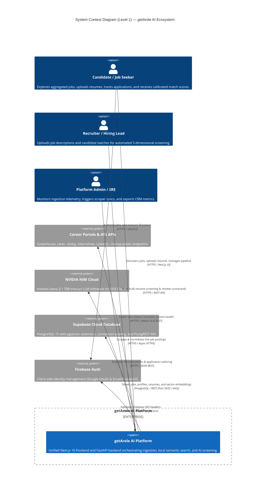
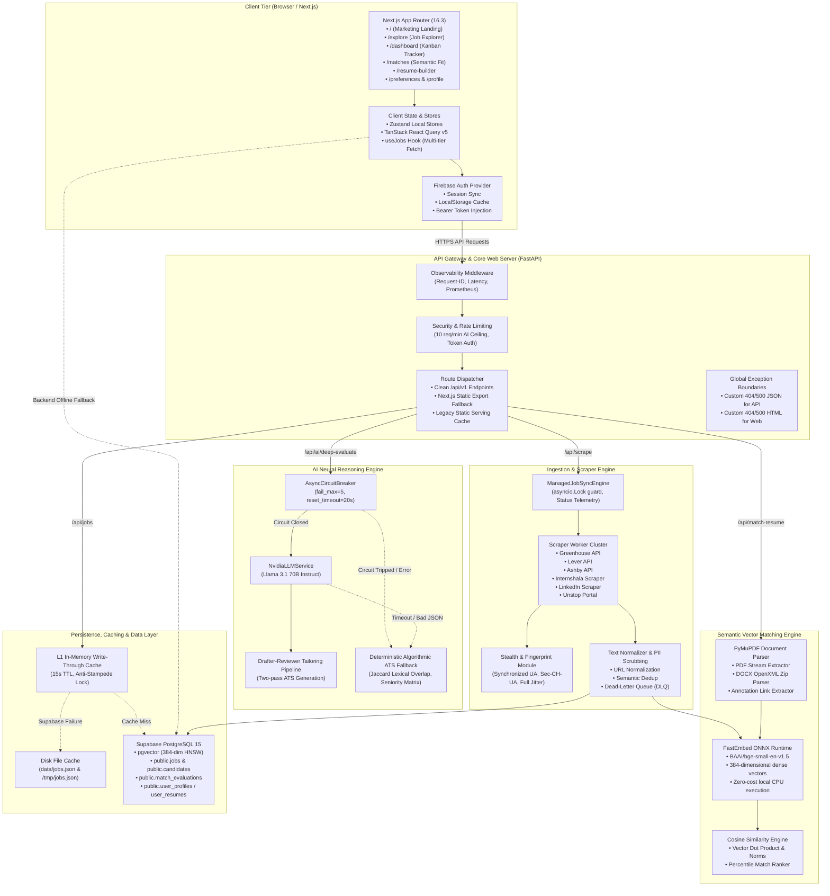
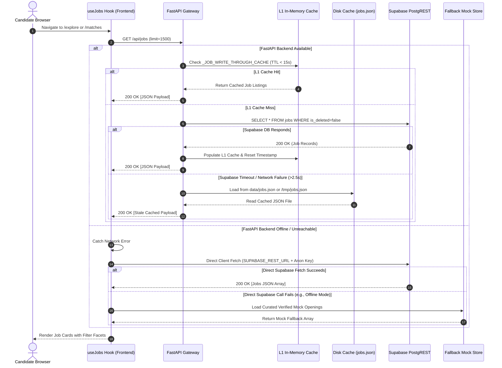
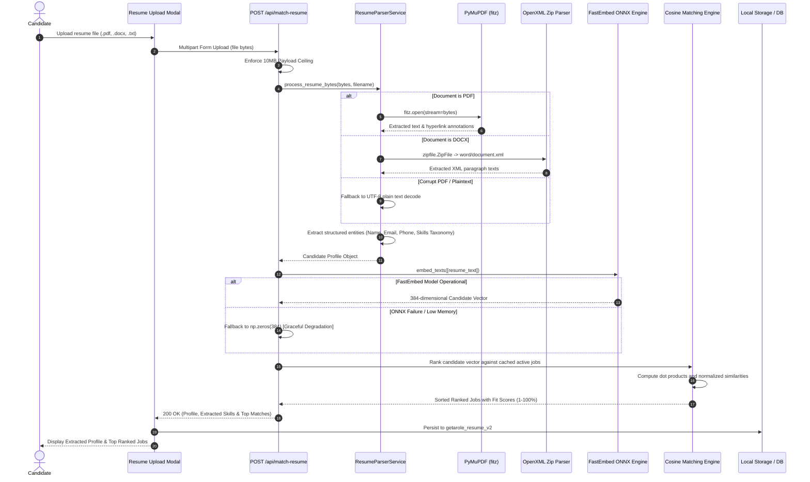
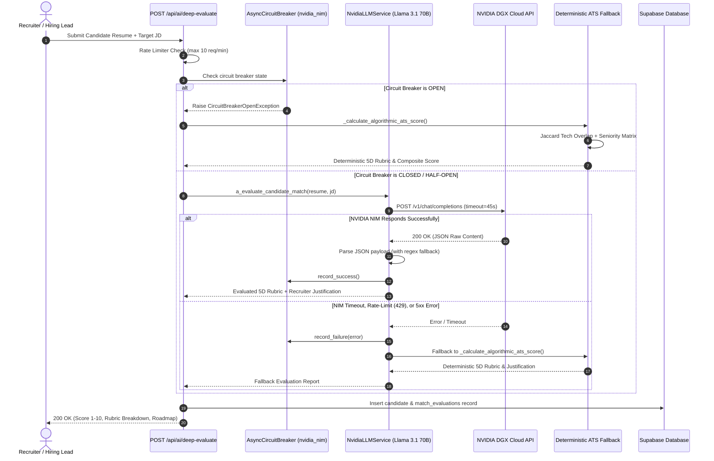
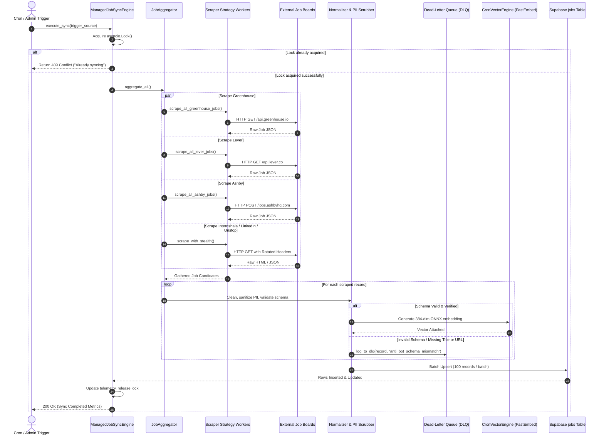
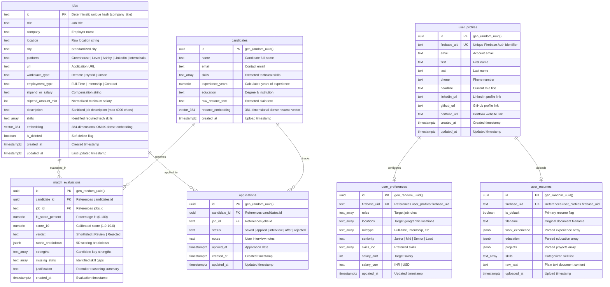
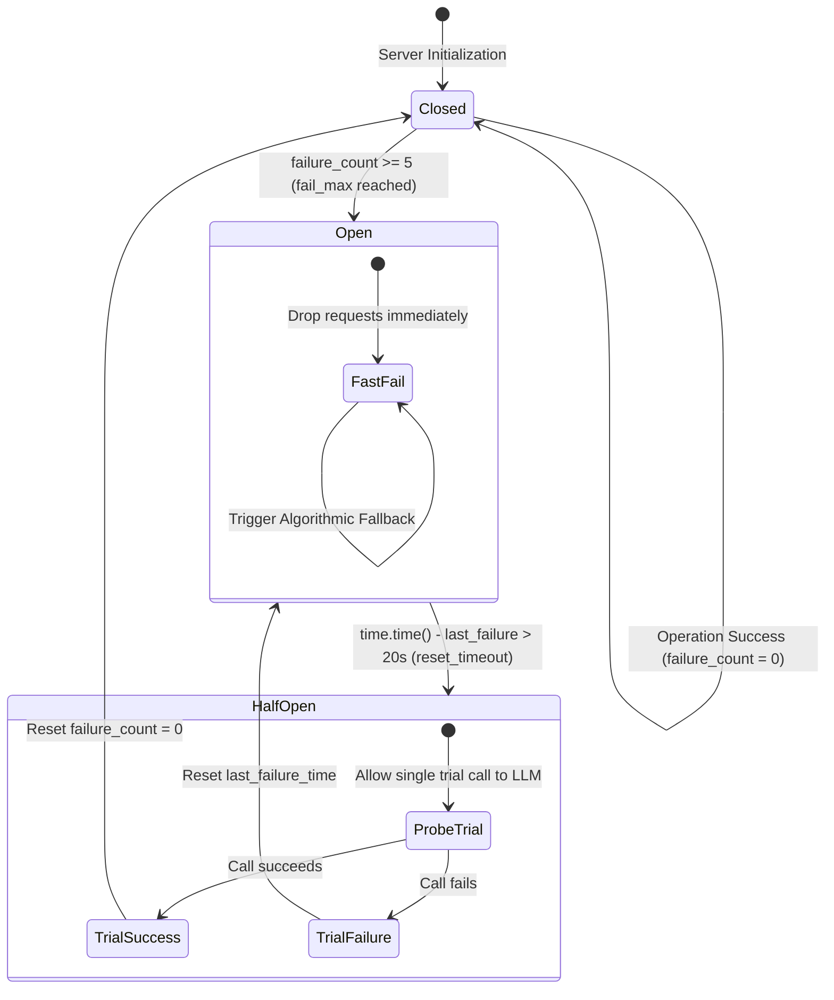
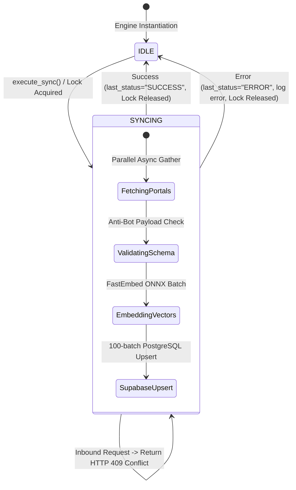
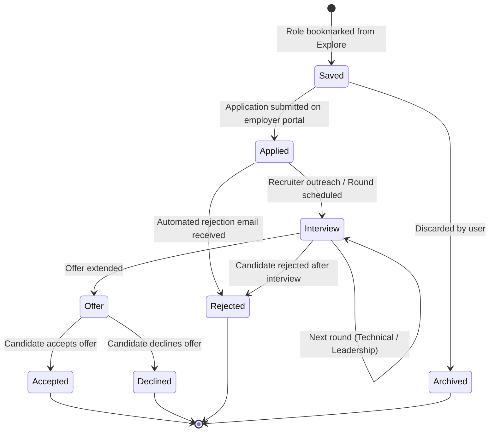

# 🏛️ getArole AI — System Design Document (SDD)
**Author:** getArole Core Engineering Team  
**System Version:** v1.1.0 (Next.js App Router + FastAPI + ONNX Local Embeddings + NVIDIA NIM Llama 3.1 70B)  
**Last Updated:** October 2026  
**Status:** Approved / Active Production Architecture  

---

## 📑 Table of Contents
1. [Executive Summary & Architectural Tenets](#1-executive-summary--architectural-tenets)
2. [High-Level System Context (C4 Context Diagram)](#2-high-level-system-context-c4-context-diagram)
3. [Container & Component Architecture (C4 Level 2 & 3)](#3-container--component-architecture-c4-level-2--3)
4. [Subsystem Deep Dives](#4-subsystem-deep-dives)
   - 4.1. Client Tier (Next.js 16 + React 19 + Tailwind v4)
   - 4.2. API Gateway & Application Server (FastAPI + Observability Middleware)
   - 4.3. Multi-Platform Scraper Aggregation & Ingestion Engine
   - 4.4. Zero-Cost Semantic Vector Matching Engine (ONNX FastEmbed)
   - 4.5. Multi-Stage AI Talent Screener (NVIDIA NIM Llama 3.1 70B)
   - 4.6. Persistence, Caching & Vector Store (Supabase + pgvector)
5. [UML Sequence Diagrams](#5-uml-sequence-diagrams)
   - Sequence 1: End-to-End Job Discovery & Multi-Tier Fallback Flow
   - Sequence 2: Resume Ingestion & Local Semantic Vector Matching
   - Sequence 3: 5-Dimensional AI Screening & Circuit Breaker Fallback
   - Sequence 4: Scheduled Multi-Platform Scraper Pipeline & DLQ Quarantine
6. [Data Architecture & Entity-Relationship Diagram (ERD)](#6-data-architecture--entity-relationship-diagram-erd)
7. [State Machine Diagrams](#7-state-machine-diagrams)
   - Circuit Breaker State Machine
   - Scraper Engine Managed Sync State Machine
   - Candidate Application Pipeline Lifecycle
8. [Security, Zero-Trust & Observability Architecture](#8-security-zero-trust--observability-architecture)

---

## 1. Executive Summary & Architectural Tenets

**getArole AI** is a high-throughput, multi-platform job aggregation and automated candidate evaluation platform. It is engineered to solve two distinct pain points in the modern technical talent market:
1. **For Job Seekers:** Fragmentation across career portals (Greenhouse, Lever, Ashby, Internshala, LinkedIn, Unstop), lack of objective ATS feedback, and generic application tailoring.
2. **For Recruiters:** Inefficient keyword-based ATS filtering, leading to false negatives and unstructured inbound candidate evaluation.

### Core Architectural Principles
* **Zero-Cost Semantic Search:** Candidate resume embedding and job vector comparisons run 100% locally on CPU via ONNX Runtime (`BAAI/bge-small-en-v1.5`), eliminating vector database and external embedding API costs.
* **Graceful Degradation & Autonomous Fallbacks:** Every subsystem (database queries, LLM evaluations, file parsing, web scrapers) contains deterministic, zero-downtime fallback paths.
* **Defense in Depth & Observability:** Prometheus latency instrumentation, structured JSON logging, strict rate-limiting ceilings, and circuit breakers protect backend infrastructure.

---

## 2. High-Level System Context (C4 Context Diagram)

---

## 3. Container & Component Architecture (C4 Level 2 & 3)

---

## 4. Subsystem Deep Dives

### 4.1. Client Tier (Next.js 16 + React 19 + Tailwind v4)
* **Architecture:** Prerendered Static Site Generation (`output: "export"`) with hydration in modern browsers.
* **Routing Structure:**
  * `/(marketing)`: Static conversion landing page, Bento feature grids, trust tickers, FAQ accordion.
  * `/(app)`: Authenticated job discovery hub (`/explore`), Kanban tracker (`/dashboard`), semantic recommendations (`/matches`), resume builder (`/resume-builder`), and profile settings (`/preferences`).
  * `/(admin)`: Recruiter CRM candidate management (`/crm`).
* **Multi-Tier Job Fetching Strategy (`useJobs` Hook):**
  1. Primary: Fetches `/api/jobs` via FastAPI backend with Axios.
  2. Secondary Fallback: Direct HTTPS client query to Supabase PostgREST endpoint using the public anonymous key.
  3. Tertiary Fallback: Verified mock dataset to guarantee the UI never displays a broken blank screen.

### 4.2. API Gateway & Application Server (FastAPI)
* **Middleware Pipeline:**
  1. `ObservabilityMiddleware`: Attaches UUIDv4 `X-Request-ID` to all HTTP headers, records duration into Prometheus histograms (`HTTP_REQUEST_DURATION_SECONDS`), and manages Prometheus metrics at `/metrics`.
  2. `GZipMiddleware`: Compresses responses over 500 bytes for accelerated Time-To-First-Byte (TTFB).
  3. `CORSMiddleware`: Whitelists domains (`https://getarole.in`, `https://getarole.com`, and Vercel preview environments).
* **Multi-Stage Prerendered Page Dispatcher (`serve_nextjs_page`):**
  * Serves Next.js static HTML from `frontend/out/` using an in-memory mtime-aware cache.
  * Falls back to `web/static/` legacy HTML templates if Next.js export assets are missing.
  * Emits custom branded 404/500 error boundaries without exposing stack traces.

### 4.3. Multi-Platform Scraper Aggregation & Ingestion Engine
* **Concurrency & Safety:** The `ManagedJobSyncEngine` utilizes an `asyncio.Lock()` to strictly prevent overlapping scraper runs. Manual or scheduled requests while a sync is in progress immediately receive HTTP 409 Conflict.
* **Platform Adapters:**
  * **Greenhouse:** Public board API querying curated technology companies.
  * **Lever:** Public careers API extracting structured titles, departments, and URLs.
  * **Ashby:** Career board GraphQL/REST ingestion.
  * **Internshala & LinkedIn:** Headless HTTP scrapers with stealth browser fingerprint rotation.
* **Resilience & Sanitization:**
  * Full Jitter Exponential Backoff retries ($t = \text{random}(0.5, \text{base} \times 2^{\text{attempt}-1})$).
  * Payload validator: Rejects any batch where $>50\%$ of records fail basic schema checks.
  * Dead-Letter Queue (DLQ) (`dlq_rejected_records.jsonl`) for quarantine and triage.

### 4.4. Zero-Cost Semantic Vector Matching Engine (ONNX FastEmbed)
* **Model:** `BAAI/bge-small-en-v1.5` dense text embedding model running on local ONNX runtime.
* **Dimensionality:** 384 dense floating-point dimensions.
* **Resource Profile:** $<200\text{ MB}$ RAM overhead, sub-15ms inference per document on commodity CPU, zero cloud API bills.
* **Mathematical Calibration:**
  $$\text{Cosine Similarity}(u, v) = \frac{u \cdot v}{\|u\|_2 \|v\|_2}$$
  Scores are calibrated to a 100-point scale: $\text{Match Score} = \min(99, \max(50, \text{round}(\text{sim} \times 100)))$.

### 4.5. Multi-Stage AI Talent Screener (NVIDIA NIM Llama 3.1 70B)
* **Inference Endpoint:** NVIDIA NIM Cloud hosting `meta/llama-3.1-70b-instruct`.
* **5-Dimensional Evaluation Rubric:**
  1. *Skills Match* (30% weight): Technical stack, languages, tools, frameworks.
  2. *Experience Alignment* (25% weight): Seniority rank, scope, production scale.
  3. *Culture & Workplace Fit* (15% weight): Remote/Hybrid/Onsite synergy.
  4. *Location Synergy* (15% weight): Proximity, timezone alignment.
  5. *Career Growth Trajectory* (15% weight): Upside velocity and headroom.
* **Composite Score Formula:**
  $$\text{Score}_{10} = 0.30 S + 0.25 E + 0.15 C + 0.15 L + 0.15 G$$
* **Circuit Breaker:** `AsyncCircuitBreaker("nvidia_nim", fail_max=5, reset_timeout=20.0s)`.
* **Drafter-Reviewer Tailoring Pipeline:**
  * Pass 1 (Drafter): Generates role-specific ATS bullet points and cover letter.
  * Pass 2 (Reviewer): Strictly audits draft against job description keywords, eliminates hallucinations, and enforces concise metric-driven wording.

### 4.6. Persistence, Caching & Vector Store (Supabase + pgvector)
* **Primary Database:** Supabase PostgreSQL 15 with `pgvector` extension.
* **Vector Index:** Hierarchical Navigable Small World (HNSW) index using cosine distance:
  `CREATE INDEX idx_jobs_embedding ON public.jobs USING hnsw (embedding vector_cosine_ops);`
* **L1 Cache Protection:** High-concurrency 15-second TTL in-memory cache with stampede locks protects the database connection pool during traffic surges.
* **User Data Concurrency:** Per-user `asyncio.Lock` guarantees serialized profile/resume writes and eliminates race conditions.

---

## 5. UML Sequence Diagrams

### Sequence 1: End-to-End Job Discovery & Multi-Tier Fallback Flow

---

### Sequence 2: Resume Ingestion & Local Semantic Vector Matching

---

### Sequence 3: 5-Dimensional AI Screening & Circuit Breaker Fallback

---

### Sequence 4: Scheduled Multi-Platform Scraper Pipeline & DLQ Quarantine

---

## 6. Data Architecture & Entity-Relationship Diagram (ERD)

---

## 7. State Machine Diagrams

### Circuit Breaker State Machine (`AsyncCircuitBreaker`)

---

### Scraper Engine Managed Sync State Machine (`ManagedJobSyncEngine`)

---

### Candidate Application Pipeline Lifecycle

---

## 8. Security, Zero-Trust & Observability Architecture

### 8.1. Zero-Trust Security Policies
* **Least-Privilege Database Access:** Public anonymous Supabase keys are strictly limited to `SELECT` on non-deleted jobs. Write access to `jobs`, `candidates`, and `match_evaluations` requires backend `service_role` credentials.
* **SSRF Protection in Document Parsing:** The `ResumeParserService` validates all extracted candidate links. Any URLs matching private IP blocks (`127.0.0.1`, `169.254.169.254`, `localhost`, `10.0.0.0/8`, `192.168.0.0/16`) or unsupported URI schemes (`javascript:`, `file:`, `data:`, `ftp:`) are stripped.
* **Payload Size Limits:** Upload endpoints strictly reject binaries exceeding 10MB to protect memory pools from Denial-of-Service (DoS) and Out-of-Memory (OOM) crashes.
* **AI Rate Limiting:** An in-memory rate limiter strictly caps AI generation endpoints to 10 requests per minute per IP address.

### 8.2. Observability & SRE Metrics
* **Prometheus Metrics Scrape (`/metrics`):**
  * `HTTP_REQUEST_DURATION_SECONDS`: Request latency distribution histogram across all endpoints.
  * `SUPABASE_QUERY_DURATION`: Database latency tracker alerting on slow queries ($>200\text{ms}$).
  * `CIRCUIT_BREAKER_STATE`: Real-time gauge ($0 = \text{Closed}, 1 = \text{Half-Open}, 2 = \text{Open}$).
  * `LLM_FALLBACK_TOTAL`: Counter tracking every activation of the deterministic ATS fallback.
  * `SCRAPER_FAILURE_TOTAL`: Counter partitioned by scraper and failure reason.
* **Kubernetes Probes:**
  * Liveness (`/healthz`): Rapid process health check returning process PID ($<5\text{ms}$).
  * Readiness (`/readyz`): Deep dependency probe validating Supabase connectivity and the 384-dimensional FastEmbed ONNX model before admitting ingress traffic.
